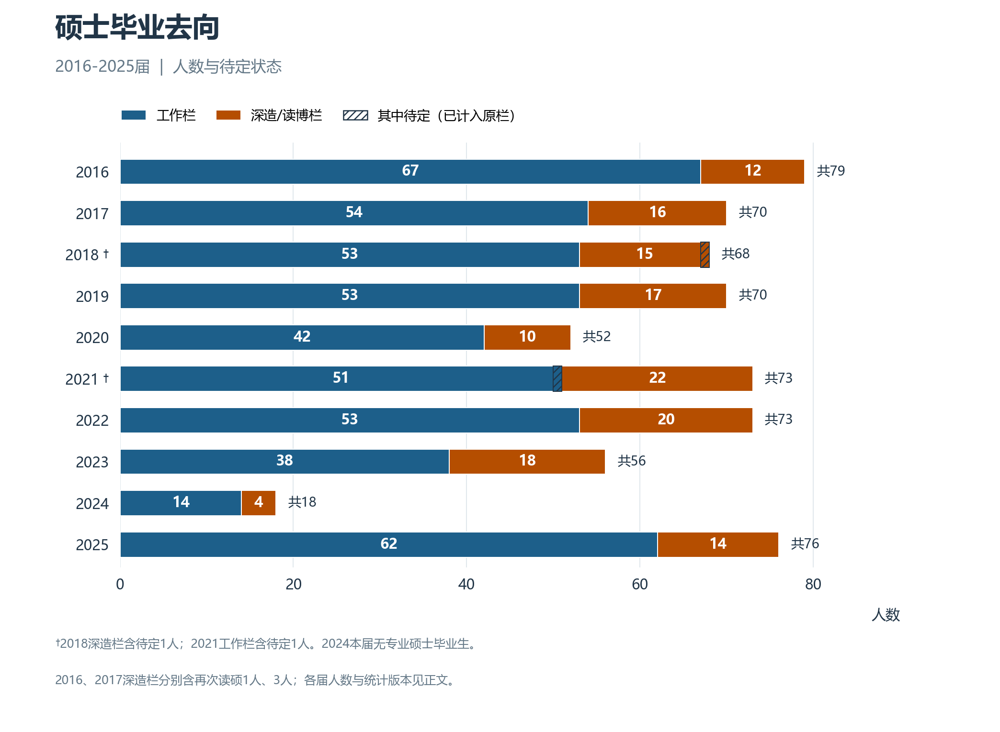
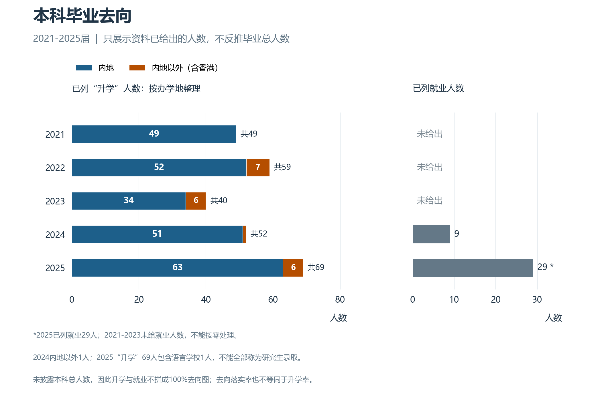
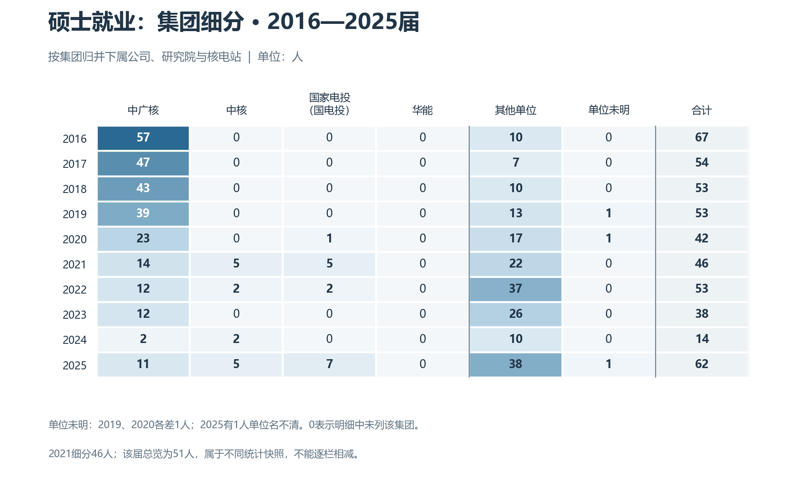
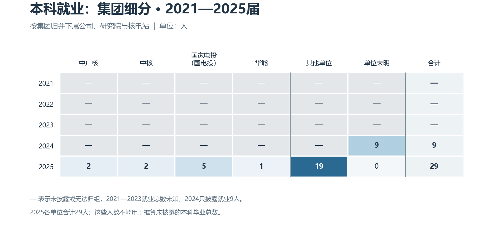
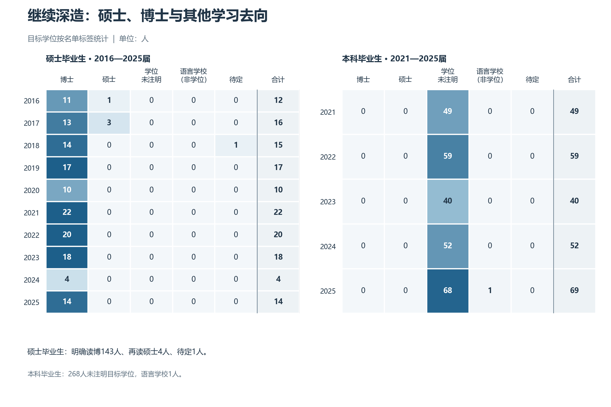
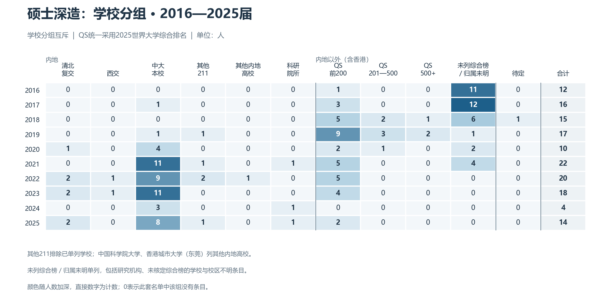
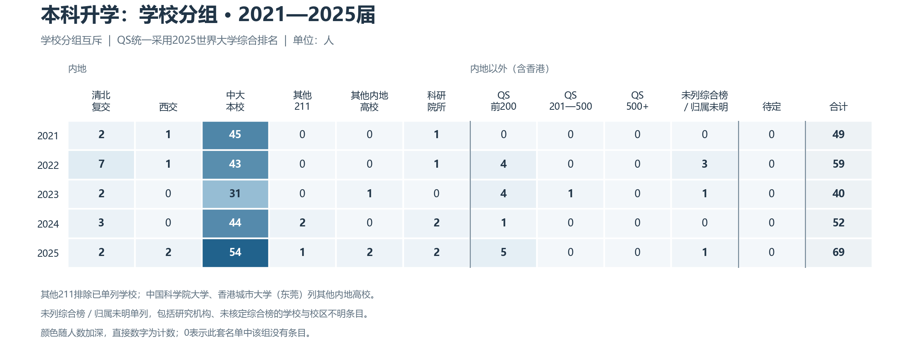

# 欢迎来到中法核

拿到录取通知书，意味着你和中法核的故事就要开始了。你可能已经对核工程有些了解，也可能还没想好自己为什么来到这里。先把报到和生活安顿好，再慢慢认识这个学院、这门专业，以及自己接下来几年的选择。

## 从录取通知书开始

拿到通知书之后，先根据当年的迎新通知，把报到时间、校区、需要携带的材料和住宿安排确认好，再规划来校的交通。按我所经历的安排，中法核的大一新生会先在广州校区南校园学习、生活一年。南校园很美，你会有足够的时间熟悉它，也在这里完成从高中生到大学生的过渡。后续年级的具体安排仍需核对当年的通知。

按照往年的经验，报到时，男女生宿舍楼的进出口附近会有迎新志愿者和热心的学长学姐，帮忙指路、答疑和发放迎新物资。有些人在积累志愿时，也有些人就是愿意来帮一把。刚到学校不熟悉流程很正常，遇到问题可以主动问。具体领取什么、在哪里领取，以当年的迎新安排为准。

从通知书到第一堂课，可以把事情分成几步：报到前确认材料和行程；到校后完成报到、入住与物资领取；安顿下来后熟悉食堂、教学楼和校园生活，再看清课表与开课通知。开学前不必急着替未来几年作出所有决定，先让自己进入大学生活的节奏。

## 中法核与普通工科的不同

谈中法核的学习体验，需要先分清两条培养路线：通常所说的“法班”和“中班”，对应学院公开介绍中的居里班与鹤绂班。不同培养方案下的课程密度和学习感受，会有明显差异。

学院后续的培养制度改革已经确认，涉及2027年或2030年后入学的年级。下面按现有安排介绍法班与中班；改革后入学的同学，应结合自己适用的培养方案阅读。

### 法班：数理基础的要求更突出

按照我的学习感受，法班需要投入大量精力应对数学和物理课程。一些课的抽象程度、推导要求和学习难度，已经接近我所理解的数学系、物理系专业核心课。这里说的是个人的学习感受，具体还要看课程内容和授课要求。

学院公开介绍也提到，居里班的数理化课程更多，部分专业课由法方教师承担；数学、物理教学重视推导演算，口试也是学习中的一部分。你需要为理解概念、推导过程和反复练习留出时间。想判断这条路线是否适合自己，可以先看实际课表，再向读过相应课程的同学了解具体体验。

### 中班：与普通工科的学习安排更接近

在我的观察中，中班的培养和学习体验，与中山大学其他普通工科专业更接近。因此，讨论“中法核的课有多难、课表有多满”时，最好先说明自己谈的是哪条路线、哪个年级。法班与中班的经验可以互相参考，也要结合各自的课程安排来理解。

两条路线的名称与教学特点可参考学院的[培养方案介绍](https://ifcen.sysu.edu.cn/article/1130)和[数理口试课堂介绍](https://ifcen.sysu.edu.cn/article/1207)。其中的具体安排有适用年份；上面的难度比较仍是编写者的个人感受。

## 本科之后可能去的方向

本科毕业后，你可以继续在本校或其他学校、科研院所深造，也可以直接求职。读完硕士之后，同样可能继续读博，或进入企业、研究院所及其他单位。下面先看总体去向，再把就业集团、目标学位和深造学校分开来看。各年材料的统计时间与完整程度不同，未披露的信息会保留空缺，不用猜测补齐。

### 先看总体去向

#### 2016—2025届硕士

总览中，2016—2021届统一采用2022年回溯地图，2022—2025届采用各届正文。图中的“工作栏”“深造／读博栏”沿用原资料标签：2018届深造15人含待定1人，2021届工作51人含待定1人，均已包含在对应栏中。

| 届别 | 原资料总数 | 工作栏 | 深造／读博栏 |
| --- | ---: | ---: | ---: |
| 2016 | 79 | 67 | 12 |
| 2017 | 70 | 54 | 16 |
| 2018 | 68 | 53 | 15 |
| 2019 | 70 | 53 | 17 |
| 2020 | 52 | 42 | 10 |
| 2021 | 73 | 51 | 22 |
| 2022 | 73 | 53 | 20 |
| 2023 | 56 | 38 | 18 |
| 2024 | 18 | 14 | 4 |
| 2025 | 76 | 62 | 14 |

2016、2017届的深造栏还分别包含再次读硕1人、3人，所以不能把整列都称为读博人数。2024年正文的18人是硕士；同文件另一幅23人地图合并了18名硕士与5名博士，不纳入此表。2025届硕士总览统计截至2026年2月，读博子段截至2026年1月。

早期长图与后来的回溯图存在人数差异；2021年当年正文又另记70人中就业46人、读博22人、待定2人。这里保留总览的回溯口径，后面的2021届就业单位细分则采用当年能完整列清单位的46人。这两种快照不能相除计算就业率，也不能把相差的5人直接解释为新增或去向未明人员。不同版本的完整数值保存在数据记录中。

#### 2021—2025届本科

本科材料没有直接给出各届毕业总人数，因此下图展示已经列出的升学和就业人数。内地与内地以外按机构办学地点划分，香港计入内地以外，香港城市大学（东莞）计入内地。

| 届别 | 已列升学人数 | 其中内地 | 其中内地以外 | 已列就业人数 |
| --- | ---: | ---: | ---: | ---: |
| 2021 | 49 | 49 | 0 | 未披露 |
| 2022 | 59 | 52 | 7 | 未披露 |
| 2023 | 40 | 34 | 6 | 未披露 |
| 2024 | 52 | 51 | 1 | 9 |
| 2025 | 69 | 63 | 6 | 29 |

2021—2023届升学人数由院校名单逐项相加，2024、2025届正文人数与名单相符。2025届就业29人来自就业图17个单位条目的加总。2021—2023届未披露就业人数；2024届虽写明就业9人，却没有逐单位名单。

材料中的升学率和去向落实率是不同指标，不能合成一条趋势线，也不能用四舍五入的比例反推本科总人数。2025届“升学”69人包含语言学校1人，不能全部视为研究生录取。

### 就业：具体进入了哪些集团和单位？

集团按用人单位归属合并，所辖研究院、核电站、工程公司和子公司均纳入对应集团。“国家电投”即国家电力投资集团，也包含材料中所称的国电投单位；核电站有多个股东时不重复计数。未属于这四个集团的已知单位列入“其他单位”，单位没有披露或无法对应的人数单列“单位未明”。

例如，苏州热工研究院、中广核研究院、台山核电、阳江核电及中广核工程单位均归中广核；中国原子能科学研究院、中国核动力研究设计院、核工业西南物理研究院归中核；上海核工程研究设计院、江西天红等归国家电投。名称带有“核”字并不足以判断集团归属，科研院所也不自动归中核。

#### 硕士毕业生

按下表细分口径，十届共列就业482人：中广核260人、中核14人、国家电投15人、华能0人，其他已知单位190人，另有3人无法确认具体单位及集团。华能为0表示这些材料的硕士单位清单没有识别出华能去向，不表示其他年份或未披露记录中不存在这种去向。

| 届别 | 中广核 | 中核 | 国家电投 | 华能 | 其他单位 | 单位未明 | 合计 |
| --- | ---: | ---: | ---: | ---: | ---: | ---: | ---: |
| 2016 | 57 | 0 | 0 | 0 | 10 | 0 | 67 |
| 2017 | 47 | 0 | 0 | 0 | 7 | 0 | 54 |
| 2018 | 43 | 0 | 0 | 0 | 10 | 0 | 53 |
| 2019 | 39 | 0 | 0 | 0 | 13 | 1 | 53 |
| 2020 | 23 | 0 | 1 | 0 | 17 | 1 | 42 |
| 2021 | 14 | 5 | 5 | 0 | 22 | 0 | 46 |
| 2022 | 12 | 2 | 2 | 0 | 37 | 0 | 53 |
| 2023 | 12 | 0 | 0 | 0 | 26 | 0 | 38 |
| 2024 | 2 | 2 | 0 | 0 | 10 | 0 | 14 |
| 2025 | 11 | 5 | 7 | 0 | 38 | 1 | 62 |

2019、2020届单位名单分别只能对应52人、41人，比对应工作栏各少1人，差额单列“单位未明”。2025届另有上海一家科技公司1人的名称无法完整辨认，集团身份无法核定，也列入“单位未明”。2021届细分采用当年完整单位名单46人；总览仍为另一快照的51人，因此本节累计482人与总览工作栏累计487人不属于同一套口径。

“其他单位”里既有华为、比亚迪、腾讯等科技企业，也有电网、银行、学校、科研机构和公务员或事业单位等去向。单位出现在就业名单时按就业统计，例如在学校任职或担任科研助理，不会因此被重复算成在该校读博。完整逐年名单见[毕业去向完整机构清单](../data/graduate-outcomes/detailed-destinations.md)。

#### 本科毕业生

本科只有2025届可以完整归并到单位：29人中，中广核2人、中核2人、国家电投5人、华能1人、其他单位19人。2024届9名就业者的单位未披露，因此四集团人数均未知，不能当作0；2021—2023届连就业总人数也未披露。

| 届别 | 中广核 | 中核 | 国家电投 | 华能 | 其他单位 | 单位未明 | 合计 |
| --- | ---: | ---: | ---: | ---: | ---: | ---: | ---: |
| 2021 | 未披露 | 未披露 | 未披露 | 未披露 | 未披露 | 未披露 | 未披露 |
| 2022 | 未披露 | 未披露 | 未披露 | 未披露 | 未披露 | 未披露 | 未披露 |
| 2023 | 未披露 | 未披露 | 未披露 | 未披露 | 未披露 | 未披露 | 未披露 |
| 2024 | 未披露 | 未披露 | 未披露 | 未披露 | 未披露 | 9 | 9 |
| 2025 | 2 | 2 | 5 | 1 | 19 | 0 | 29 |

### 深造：读硕士、读博士，还是目标学位没有注明？

这里的“硕士”和“博士”指接下来攻读的目标学位，与毕业前的学生层次分开。已获硕士学位后再次读硕，也仍计入目标学位“硕士”；语言学校单列为非学位学习。

2016—2025届硕士的深造栏合计148人，其中明确读博143人、再次读硕4人、待定1人。读硕4人分别出现在2016届与2017届的名单中。

| 届别 | 博士 | 硕士 | 学位未注明 | 语言学校（非学位） | 待定 | 合计 |
| --- | ---: | ---: | ---: | ---: | ---: | ---: |
| 2016 | 11 | 1 | 0 | 0 | 0 | 12 |
| 2017 | 13 | 3 | 0 | 0 | 0 | 16 |
| 2018 | 14 | 0 | 0 | 0 | 1 | 15 |
| 2019 | 17 | 0 | 0 | 0 | 0 | 17 |
| 2020 | 10 | 0 | 0 | 0 | 0 | 10 |
| 2021 | 22 | 0 | 0 | 0 | 0 | 22 |
| 2022 | 20 | 0 | 0 | 0 | 0 | 20 |
| 2023 | 18 | 0 | 0 | 0 | 0 | 18 |
| 2024 | 4 | 0 | 0 | 0 | 0 | 4 |
| 2025 | 14 | 0 | 0 | 0 | 0 | 14 |

2021—2025届本科升学名单合计269人，其中268人的目标学位没有在附件中逐条说明，另有语言学校1人。即使其中一些路径通常被理解为读研，也不能据此把268人全部改写成读硕；“硕士0、博士0”的含义是没有得到附件的明确学位标注，并非实际无人读硕或读博。

| 届别 | 博士 | 硕士 | 学位未注明 | 语言学校（非学位） | 待定 | 合计 |
| --- | ---: | ---: | ---: | ---: | ---: | ---: |
| 2021 | 0 | 0 | 49 | 0 | 0 | 49 |
| 2022 | 0 | 0 | 59 | 0 | 0 | 59 |
| 2023 | 0 | 0 | 40 | 0 | 0 | 40 |
| 2024 | 0 | 0 | 52 | 0 | 0 | 52 |
| 2025 | 0 | 0 | 68 | 1 | 0 | 69 |

### 深造学校：按内地类别与QS 2025分组

内地学校按互斥的六类统计：清北复交指清华大学、北京大学、复旦大学和上海交通大学；西交指西安交通大学；中大本校指中山大学；“其他211”排除前面已经单列的学校，并包含其他985高校；其余分为“其他内地高校”和“科研院所”。每人只进入一类，避免重复计算。

内地以外院校统一采用**QS 2025世界大学综合排名**，划分为前200、201—500、500名以后；第200名只计入前200。未进入该综合榜的机构、研究中心、语言学校，或无法从附件唯一对应排名主体的名称，单列为“境外未列综合排名／归属未明”，不直接并入QS500+。旧校名与成员院校只有在机构关系能够明确核实时才匹配对应排名主体；按同一版排名回看历届，仅用于统一分组。

#### 硕士毕业生的深造学校

十届硕士深造名单中，中大本校48人，清北复交7人，西交2人，其他211高校5人，其他内地高校1人，内地科研院所3人；内地以外QS前200院校36人，201—500名6人，500名以后3人，未列综合排名或无法唯一匹配36人，另有待定1人。CEA、EDF等以实验室或企业名义列出的博士去向，不能直接替换成未注明的学位授予大学。

#### 本科毕业生的深造学校

五届本科名单中，中大本校217人，清北复交16人，西交4人，其他211高校3人，其他内地高校3人，科研院所6人；内地以外QS前200院校14人，201—500名1人，未列综合排名或无法唯一匹配5人，后者包含2025届语言学校1人。

两类毕业生的累计分组如下。逐年学校分组可查看[学校分组CSV](../data/graduate-outcomes/study-groups.csv)，具体校名和单位名见[完整机构清单](../data/graduate-outcomes/detailed-destinations.md)。

| 学校／机构分组 | 硕士毕业生（2016—2025届） | 本科毕业生（2021—2025届） |
| --- | ---: | ---: |
| 清北复交 | 7 | 16 |
| 西交 | 2 | 4 |
| 中大本校 | 48 | 217 |
| 其他211 | 5 | 3 |
| 其他内地高校 | 1 | 3 |
| 科研院所 | 3 | 6 |
| QS前200 | 36 | 14 |
| QS201-500 | 6 | 1 |
| QS500+ | 3 | 0 |
| 境外未列综合排名／归属未明 | 36 | 5 |
| 待定 | 1 | 0 |
| 合计 | 148 | 269 |

2022届本科名单中，“圣埃蒂安”和“圣太田”两个相近译名各列1人，均按原条目保留，不能仅因校名相近就删去其中一人。学校分组统计的是材料披露的机构与人数，不能补充材料没有说明的专业、学位授予关系或录取类型。

### 从这些去向里，可以看到哪些变化？

把历年数据放在一起看，本科与硕士呈现出的变化并不完全相同。本科最稳定的特点，是本校在已列升学去向中始终占多数；硕士则在用人单位的集团构成和继续深造的地域上，都出现了比较明显的变化。下面涉及的构成比例，都以对应分表中该届已列人数为分母；本科没有披露完整毕业人数，学校占比和单位占比不能理解为占全体本科毕业生的比例。

#### 本科升学：本校仍是主要去向，境外人数有起伏

2021—2025届已列出的269个升学或继续学习去向中，中大本校有217人，占80.7%；其他内地高校和科研院所合计32人，内地以外20人。分届来看，本校占各届升学名单的比例依次为91.8%、72.9%、77.5%、84.6%、78.3%，每届都超过七成。本校比例有升有降，但在这五届材料中，继续留在中大始终是最常见的升学路径。

内地以外的去向则没有持续增加或减少：五届人数依次为0、7、6、1、6，对应各届升学名单的0%、11.9%、15.0%、1.9%、8.7%。2025届的6人里还有语言学校1人，需要和大学、科研机构的深造去向分开理解。名单中的清北复交、西交、其他高校和科研院所，说明本校之外也存在多种路径；目前这些路径的人数变化主要表现为届间起伏。

另一个可以直接比较的指标，是材料公布的2021—2023届本科升学率：79.03%、74.68%、69.0%，三届之间下降了10.03个百分点。后两届给出的是不同含义的去向落实率，没有可直接接续的升学率。因此，2025届升学名单增加到69人，只能说明已列人数比前几年多，不能据此判断升学率已经回升。附件也没有逐条注明本科生后续攻读的学位，无法进一步判断读硕与直博比例如何变化。

#### 本科就业：能看清最近一届的结构，长期变化仍缺资料

本科就业目前只有2024、2025两届提供了人数，分别为9人和29人；2024届又缺少单位明细。2025届29名已列就业者中，有10人进入中广核、中核、国家电投和华能四个集团，占34.5%；其余19人占65.5%，分布于其他企业、学校、教育培训机构和公共部门等单位。四个单列集团之外的就业出口，已经明确出现在这届名单里。

从9人增加到29人，是已披露就业人数的增加。由于各届本科毕业总人数、早期就业人数和单位分布不完整，这两个数字还不足以说明就业率上升，也无法判断某一集团或某类行业在本科就业中的占比是否长期扩大。目前能够看清的是最近一届的去向结构；要分析本科就业的长期变化，还需要补齐前几届同一口径的资料。

#### 硕士就业：仍是主要出口，对中广核单一集团的集中程度下降

硕士总览中，每届工作栏都占该届资料总数的三分之二以上，约在67.9%—84.8%之间，毕业后工作始终是主要去向。这是工作与继续深造的分流结构，不能直接称为就业率；例如2021届工作栏还包含待定1人。2024届又只有18名硕士、没有专业硕士毕业生，因此不能用2025届工作人数从14人增加到62人，判断就业形势大幅改善。

具体到用人单位，变化最明显的是对中广核单一集团的集中程度。2016—2019届，中广核及其下属单位占各届就业细分人数的73.6%—87.0%；2022—2025届则为14.3%—31.6%。2025届有11人进入中广核，占该届62名已列就业人数的17.7%。这一变化并非逐年下降，但近几届与早期相比，名单中的就业去向已不再如此集中于同一个集团，科技、制造、电网、教育、科研和公共部门等多类单位也占据了相当份额。

同时，其他核能集团仍在承接毕业生。2025届进入中核5人、国家电投7人，加上中广核，四个单列集团合计23人，占37.1%，高于2022—2024各届的28.6%—31.6%。“其他单位”中还包括能源企业和科研机构，因此这里能够确认的是集团构成发生变化，不能据此统计有多少人离开核行业或转行。2021届的集团比例也只按完整单位名单46人计算，不与总览51人的快照混用。

#### 硕士深造：读博仍是主体，地域重心转向内地

硕士继续深造的地域变化，比深造人数本身的增减更清楚。2016—2019届，内地以外去向占每届深造栏的88.2%—100%；2020届内地与内地以外各5人，此后2021—2025每届都以内地为主。2022、2023、2025届的内地以外人数分别为5、4、2人，占各届深造栏的25.0%、22.2%、14.3%；2024届仅列深造4人，全部在内地，样本较小。

在这一变化中，中大本校成为重要落点。2021—2025届本校人数分别为11、9、11、3、8人，每届占深造栏45.0%—75.0%；2025届14个深造去向中，有8个在本校。材料能支持的判断是，硕士深造从早年以内地以外为主，转向近年以内地、尤其本校为主。它没有说明变化由哪些因素造成，不能单凭这些人数将原因归结为招生政策、个人偏好或外部环境。

从目标学位看，硕士继续深造一直以读博为主体，但深造在全届中的比例有明显起伏。深造栏占该届资料总数的比例，从2016届的15.2%到2023届的32.1%，随后在2025届回落到18.4%，并不是逐年上升或下降。地域构成转向内地，与是否有更多人选择继续深造，是两个需要分开观察的问题。

学校排名分组也有比较边界。按统一QS 2025口径，2022—2025届所列的11个内地以外深造去向都在前200组；早期名单却有不少CEA、EDF、工程师学校或研究中心，无法直接对应同一综合榜中的大学主体。这种机构名称和可识别程度的差异，会影响排名分组，不能仅凭前200组的占比判断历届深造质量提高或降低。

## 这本手册怎么帮你

第一年可以先了解两条培养路线的实际课程，听听不同年级的经历，再逐步考虑深造和工作的方向。毕业去向给你的是已经出现过的路径，课程和经历则帮助你判断自己愿意为哪条路径投入时间。后面的学习、法语、实习、科研与升学章节，会继续把这些问题展开。

本节的口径说明与数据文件见[毕业去向数据说明](../data/graduate-outcomes/README.md)，逐年单位和学校见[完整机构清单](../data/graduate-outcomes/detailed-destinations.md)。图表和表格只展示统计项目；附件信息、不同版本和归并核验单独保存在[原始记录](../data/graduate-outcomes/source-records.json)与[细分核验记录](../data/graduate-outcomes/classification-audit.json)中。

---

[手册首页](../README.md) · [完整目录](../SUMMARY.md)
